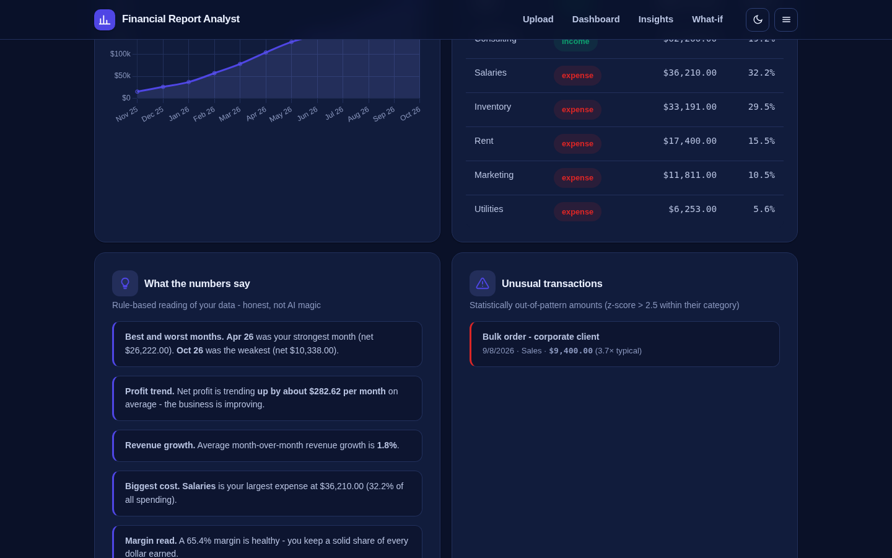
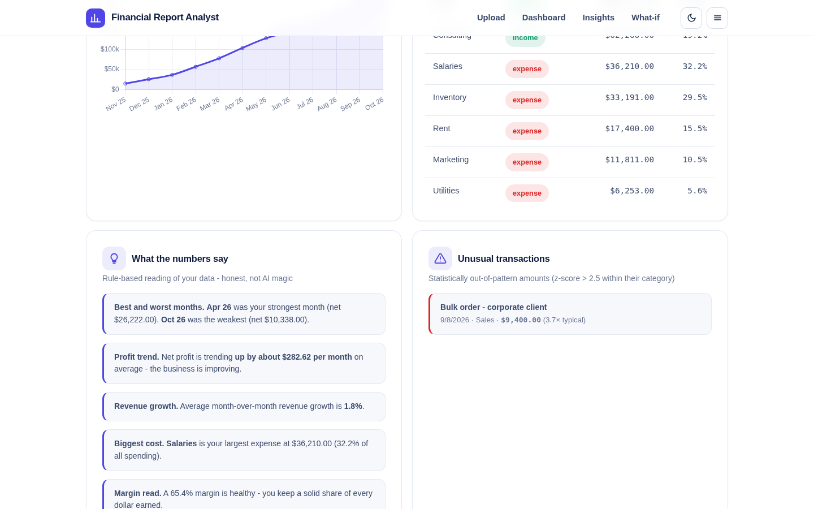

# Financial Report Analyst

Turn a P&L, bank statement export or any CSV/Excel file with amounts into a full financial report - KPIs, monthly trends, category breakdowns, anomaly flags, plain-language insights and a what-if planner. Everything runs **100% in the browser**: no server, no sign-up, no uploads, free forever.

**Live:** https://akash991833.github.io/financial-report-analyst/




## Features

- **Any export in**: CSV, TSV or Excel (.xlsx/.xls). Column mapping with smart auto-detection (date / description / category / amount, signed or debit-credit style). Common date formats understood (YYYY-MM-DD, DD/MM/YYYY, MM/DD/YYYY, month names, Excel serials).
- **KPI tiles**: revenue, expenses, net profit, margin, average net per month, month-over-month change.
- **Charts** (Chart.js): monthly revenue vs expenses with net line, expense share doughnut, cumulative net cash area.
- **Plain-language insights**: best/worst month, profit trend slope, revenue growth, cost concentration warnings, margin health read, largest single expense.
- **Anomaly flags**: transactions statistically outside their category's normal range (z-score > 2.5).
- **Filters**: period (3/6/12 months), category, free-text search; sortable paginated transaction table.
- **What-if planner**: sliders for revenue change, expense change and horizon; projected monthly and cumulative net.
- **Exports**: filtered CSV, Markdown report, print/PDF.
- **Try instantly**: built-in sample business (12 months, seeded and deterministic).
- **PWA**: installable, works offline after first load, dark + light themes, fully responsive.

## Honest limits

- Insights are rule-based readings (trend, concentration, outlier statistics) - not audited financial advice.
- Ambiguous date formats are guessed and can be corrected in the mapping step.
- Data lives only in your browser tab; it is gone when you close it (nothing is stored or sent anywhere).

## Tech

Vanilla JS + Chart.js + SheetJS (vendored, no CDN dependency at runtime). No build step, no tracking.

## Run locally

```bash
python3 -m http.server 8080
# open http://localhost:8080
```

## Tests

`tests/run.mjs` is a Puppeteer suite that loads the sample business and verifies KPIs, insights, anomaly flags, charts, the what-if planner, filters and pagination across desktop/mobile x light/dark, and fails on any console error.

```bash
python3 -m http.server 8051 &
NODE_PATH=../node_modules node tests/run.mjs
```

## Python version (pandas + pdfplumber + Streamlit)

A pro-grade rebuild with real PDF statement parsing and subscription detection lives in [`python-app/`](python-app/) - see its README for run steps. The browser demo above stays the zero-install option.
